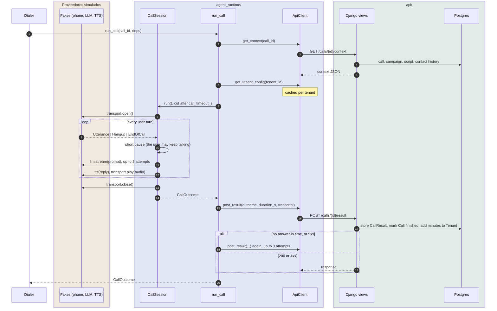
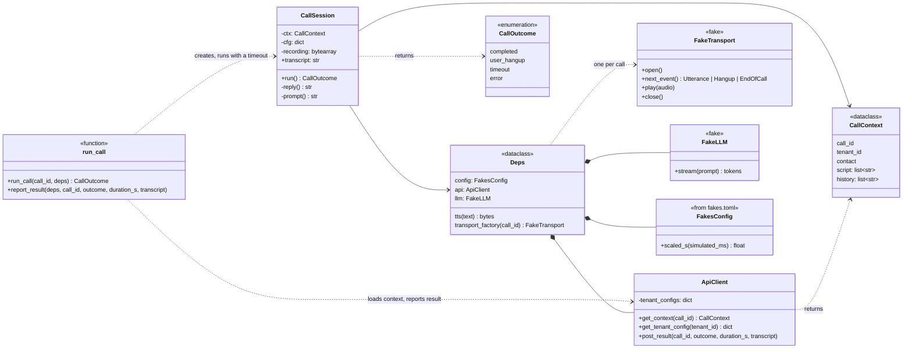
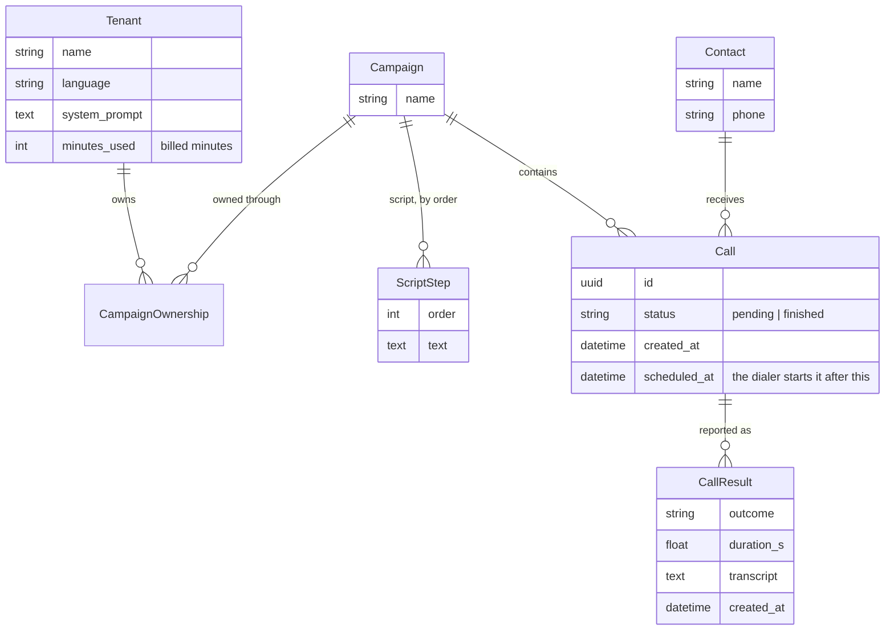

# El código

Un runtime asíncrono que hace llamadas telefónicas con un agente de voz (`agent_runtime/`) y la API
de Django con la que habla (`api/`).

## Qué puedes cambiar

| | Rutas | Por qué |
| --- | --- | --- |
| 🔒 **No cambiar** | `agent_runtime/fakes.py`, `fakes.toml`, `api/calls/middleware.py` | Simulan los proveedores externos y las condiciones de producción |
| | `api/calls/migrations/0001_initial.py` | Ya aplicada en producción: añade migraciones nuevas |
| ⚠️ **Ampliar sin romper** | `run_call(call_id, deps) -> CallOutcome`, `build_deps()`, `Deps` | Los usa el marcador automático (dialer). Puedes añadir `no_answer` a `CallOutcome` |
| | Los tres endpoints HTTP | Mantén rutas y campos. `POST /result` responde 200 a una petición idéntica repetida |
| ✅ **Tuyo** | Todo lo demás | Incluidos módulos, migraciones y tests nuevos |

## Flujo de información

El marcador automático (dialer), que no está en este repositorio, inicia cada llamada pendiente (`Call`)
en cuanto llega su hora programada (`scheduled_at`).
En el diagrama, cada bloque es una parte del repositorio: el runtime (`agent_runtime/`), la API (`api/`) y
los proveedores simulados (`agent_runtime/fakes.py`), que hacen de servicios externos.

| Resultado | Cuándo |
| --- | --- |
| `completed` | La conversación llegó a su final natural |
| `user_hangup` | El usuario colgó |
| `timeout` | La llamada duró más de `call_timeout_s` |
| `error` | Cualquier otra cosa: no se pudo cargar el contexto, el LLM siguió fallando, … |

## Clases del runtime

- `runner.py` y `session.py` nunca construyen sus dependencias: las reciben en `Deps`, así que un
  test puede cambiar cualquiera (`tests/test_runtime.py` sustituye la API por una en memoria).
- Excepciones: `NoAnswer` (`transport.open()`, nadie descuelga), `LLMError` (falla el stream del
  LLM) y `TimeoutError` (el timeout de `run_call`).
- Las duraciones simuladas se multiplican por `time_scale`, así que una llamada de 180 s dura unos 9 s.

## API y modelo de datos

| Endpoint | Qué devuelve o hace |
| --- | --- |
| `GET /calls/{id}/context` | `{call_id, tenant: {id}, contact: {name, phone}, script: [{order, text}], history: [{outcome, created_at}]}`. El historial son las 20 últimas llamadas terminadas del contacto |
| `GET /tenants/{id}/config` | `{language, system_prompt}` |
| `POST /calls/{id}/result` | Cuerpo `{outcome, duration_s, transcript}`. Guarda un `CallResult`, marca la llamada como terminada y suma `ceil(duration_s / 60)` a `Tenant.minutes_used` |

`make seed` carga tres tenants de tamaños muy distintos: acme (50 llamadas pendientes), beta (250) y
gamma (700, con 15–20 llamadas terminadas por contacto).

## Cómo arrancarlo

- `make up` levanta Postgres y la API en Docker. La API se recarga al guardar.
- `make dbshell` abre `psql`. Para cambiar el esquema: edita `models.py` y luego `make makemigrations`
  y `make up`.
- En un test, `CaptureQueriesContext(connection)` cuenta las consultas, y
  `pytest.mark.django_db(transaction=True)` permite que varios hilos vean los commits de los demás.
